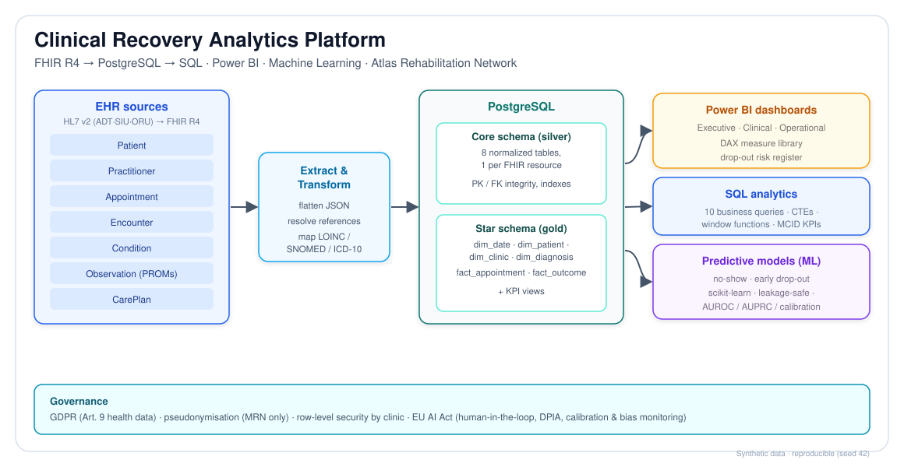
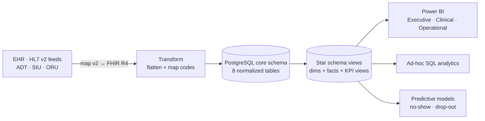

# Clinical Recovery Analytics Platform — FHIR · SQL · Power BI


> An end-to-end **Health Informatics Analyst** portfolio project. It simulates
> the work of an analyst in a network of outpatient physiotherapy clinics:
> real-world **HL7 v2** feeds (ADT · SIU · ORU) are mapped to **FHIR R4**, then
> flattened into a governed
> **PostgreSQL** star schema, analysed in **SQL** (window functions, CTEs,
> MCID-based outcome KPIs), surfaced in three **Power BI** dashboards, and
> extended with two **predictive models** (no-show & drop-out) — all under
> **GDPR** and **EU AI Act** governance.

**Tech:** HL7 v2 · FHIR R4 · PostgreSQL · SQL · Power BI / DAX · Python · scikit-learn
**Domain:** outpatient MSK physiotherapy · interoperability · clinical & operational analytics
**Data:** 100% synthetic, reproducible (`seed = 42`). No real patient data.
**Quality:** 33 tests (pytest) · GitHub Actions CI · MIT licensed

> 👉 **Quick look:** open [`index.html`](index.html) in any browser for an
> interactive dashboard (KPIs + charts, no setup). It can also be published as a
> live page via **GitHub Pages** (Settings → Pages → deploy from `main`).

---

## Why this project exists

A physiotherapy network (the fictional **Atlas Rehabilitation Network**, 8
clinics, ~110 physiotherapists, ~45k visits/year) had no shared view of its
outcomes, no-shows or treatment drop-out. This project builds the data platform
that makes those things measurable and **actionable** — the core job of a Health
Informatics Analyst.

## Architecture



<details><summary>Text version (Mermaid)</summary>



</details>

## Key results (computed from the synthetic data)

| Metric | Value |
|--------|-------|
| Appointments analysed | **64,213** |
| Care episodes | **5,467** (4,500 patients) |
| PROMs (outcome measures) | **20,790** |
| No-show rate / lost capacity | **11.4% / 18.0%** (~8,500 clinician-hours) |
| No-show by booking lead time | **9.9%** (≤2 days) → **15.3%** (≥14 days) |
| Treatment completion / drop-out | **76% / 24%** of closed episodes |
| Functional MCID achievement | **93.9%** (pain 6.4 → 2.7 NPRS) |
| Active patients flagged at risk of drop-out | **182** (67 high) |
| Drop-out model (early-warning) | **AUROC 0.66**, top-quintile catches 41% of drop-outs |

## Repository structure

```
.
├── README.md                     ← you are here
├── index.html                     interactive dashboard (open in a browser)
├── LICENSE                        MIT
├── data/
│   ├── generate_synthetic_data.py   reproducible data generator
│   └── *.csv                         generated dataset (8 files)
├── hl7v2/                         HL7 v2 messages (ADT/SIU/ORU) + v2→FHIR mapper
│   ├── messages/*.hl7
│   └── hl7v2_to_fhir.py
├── fhir/                          FHIR R4 example resources + transaction Bundle
│   ├── patient.json  practitioner.json  appointment.json  encounter.json
│   ├── condition.json  observation-disability.json  observation-pain.json
│   ├── careplan.json  bundle-episode-transaction.json
├── sql/
│   ├── 01_schema_ddl.sql            core relational schema (DDL)
│   ├── 02_load_data.sql             load CSVs (\copy)
│   ├── 03_star_schema.sql           dims + fact views (incl. fact_outcome)
│   ├── 04_analytical_queries.sql    the 10 business-question queries
│   └── 05_kpi_views.sql             KPI views for Power BI
├── powerbi/
│   ├── dax_measures.dax             full DAX measure library
│   └── README.md                    model + connection notes
├── ml/                            predictive models (scikit-learn)
│   ├── features.py                  leakage-safe feature engineering
│   ├── train_noshow.py             no-show model
│   ├── train_dropout.py            early drop-out model
│   ├── _eval.py  requirements.txt  README.md
│   └── outputs/                     metrics JSON + evaluation plots
├── notebooks/
│   └── clinical_recovery_walkthrough.ipynb   executed end-to-end demo
├── tests/                         pytest suite (data-quality + HL7) — 33 tests
├── .github/workflows/ci.yml       GitHub Actions CI (regenerate + test)
├── presentation/                  interview deck (.pptx) + one-pager (.pdf)
├── assets/                        architecture diagram (SVG/PNG)
└── docs/
    ├── 01_business_context.md       Phase 1 — org, problems, KPIs, stakeholders
    ├── data_dictionary.md           tables, columns, views reference
    ├── 02_fhir_model.md             Phase 2 — FHIR resources, relations, flow
    ├── 03_extraction_normalization.md  Phase 3 — FHIR→SQL ETL & schema
    ├── 04_sql_analytics.md          Phase 4 — queries + verified results
    ├── 05_powerbi.md                Phase 5 — three dashboards + DAX
    ├── 06_clinical_insights.md      Phase 6 — insights, actions, limitations
    ├── 07_ai_future.md              Phase 7 — predictive AI + GDPR/EU AI Act
    ├── 08_portfolio.md              Phase 8 — GitHub/LinkedIn/CV/interview
    ├── 09_hl7v2_integration.md      Phase 9 — HL7 v2 → FHIR ingestion
    ├── data_dictionary.md           tables & views reference
    └── GUIA_COMPLETA.md             complete step-by-step manual (Spanish)
```

## Quickstart

```bash
# 1) Generate the synthetic dataset (~4s, writes CSVs to /data)
python data/generate_synthetic_data.py

# 2) Build & load in PostgreSQL
createdb arn_db
psql -d arn_db -f sql/01_schema_ddl.sql
psql -d arn_db -f sql/02_load_data.sql       # run from the repo root
psql -d arn_db -f sql/03_star_schema.sql
psql -d arn_db -f sql/05_kpi_views.sql

# 3) Explore the analytics
psql -d arn_db -f sql/04_analytical_queries.sql

# 4) Power BI: connect to the views (or import the CSVs) and paste in the
#    measures from powerbi/dax_measures.dax — see docs/05_powerbi.md

# 5) Predictive models
pip install -r ml/requirements.txt
python ml/train_noshow.py
python ml/train_dropout.py

# 6) Or open the executed walkthrough (data → SQL → KPIs → models)
jupyter lab notebooks/clinical_recovery_walkthrough.ipynb
```

*No PostgreSQL handy?* The queries are standard SQL and also run on DuckDB (the
only shim needed is a `to_char` macro) — handy for a quick local demo.

## Documentation

Start with [`docs/01_business_context.md`](docs/01_business_context.md) and read
through to Phase 8. Each phase is self-contained and cross-linked. The predictive
models are documented in [`ml/README.md`](ml/README.md), and every table and view
is described in the [data dictionary](docs/data_dictionary.md). A complete
step-by-step **manual in Spanish** is in
[`docs/GUIA_COMPLETA.md`](docs/GUIA_COMPLETA.md), and an **interview deck** +
**one-page summary** are in [`/presentation`](presentation).

## Testing & CI

`pytest -q` runs **28 data-quality checks** (primary-key uniqueness, foreign-key
integrity, valid code sets, and plausible KPI ranges). The same suite runs in
**GitHub Actions** ([`.github/workflows/ci.yml`](.github/workflows/ci.yml)),
which regenerates the dataset, runs the tests, executes a SQL smoke test and
trains the models on every push.

## License

[MIT](LICENSE). All data is synthetic; no real patient information is included.

## Governance & honesty

- **Synthetic data only.** Generated by `data/generate_synthetic_data.py`; no
  real patients. All quoted figures come from that dataset and are reproducible.
- **GDPR:** names dropped, address minimised to postal code, MRN-only in
  reporting, row-level security by clinic (see Phase 7).
- **EU AI Act:** predictive models are scoped with current (June 2026)
  classification and timeline in mind (see Phase 7 and `ml/README.md`).

## Sources (external facts referenced)

- FHIR version choice (R4 as production baseline; R5 ~5% adoption; R6 emerging):
  [Health Samurai — FHIR R4 vs R5 vs R6 (2026)](https://www.health-samurai.io/articles/fhir-r4-vs-fhir-r5-choosing-the-right-version-for-your-implementation),
  [1upHealth — FHIR Versioning (2026)](https://1up.health/blog/fhir-versioning-and-how-to-still-stay-up-to-date/)
- EU AI Act status & 2026 "Digital Omnibus" timeline relief for high-risk systems:
  [Covington — EU AI Act Update: Timeline Relief (May 2026)](https://www.globalpolicywatch.com/2026/05/eu-ai-act-update-timeline-relief-targeted-simplification-and-new-prohibitions/),
  [EU AI Act — Article 6 (high-risk classification)](https://artificialintelligenceact.eu/article/6/),
  [EU AI Act Service Desk — implementation timeline](https://ai-act-service-desk.ec.europa.eu/en/ai-act/timeline/timeline-implementation-eu-ai-act)
- Clinical context (PROMs/MCID for MSK physiotherapy: NPRS, ODI, NDI, QuickDASH,
  LEFS) reflects standard physiotherapy practice; LOINC codes for survey
  instruments should be validated against [loinc.org](https://loinc.org) before
  production use.

---

*Built as a learning portfolio to demonstrate Health Informatics Analyst
competencies: clinical domain modelling, interoperability (FHIR), SQL/data
modelling, BI design, predictive modelling and data governance.*
