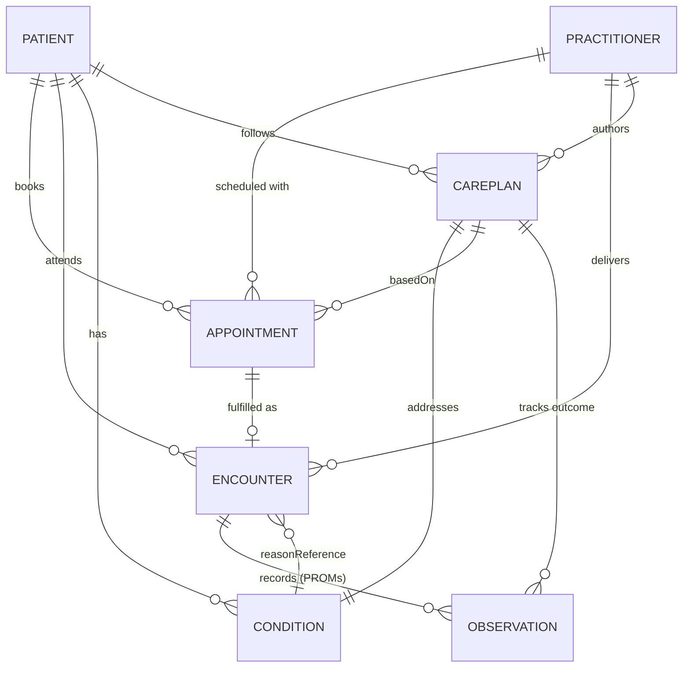
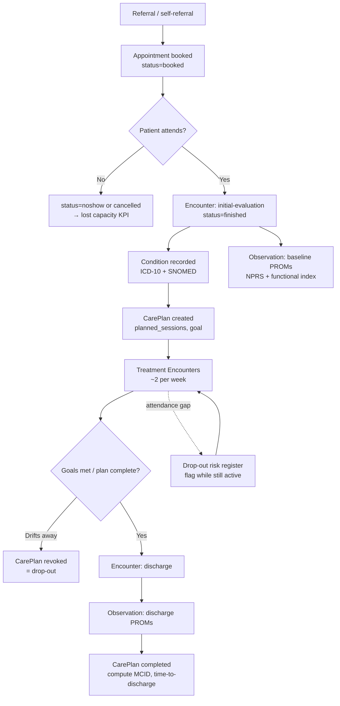

# Phase 2 — FHIR Data Model

## 2.1 Why FHIR, and which version

**FHIR (Fast Healthcare Interoperability Resources, HL7)** is the de-facto
standard API for exchanging clinical data. Building the analytics platform on
FHIR means ARN's data model is aligned with the EHR's native API, with national
interoperability programmes, and with any future partner (insurer, hospital,
research) — instead of a bespoke schema that only ARN understands.

**Version: FHIR R4.** R4 is the production baseline used by the large majority
of live FHIR implementations and national profiles; R5 adoption remains low
(~5%) and R6 is still emerging. Building on R4 maximises compatibility today
while leaving a clean R4→R6 migration path later. *(Verified June 2026 — see
sources in the root README.)*

Full, valid example resources live in [`/fhir`](../fhir). The snippets below are
abbreviated; the files are the source of truth.

## 2.2 Resources selected and the rationale

The platform needs to answer scheduling, clinical and outcome questions. Each of
the seven core resources maps to one of those needs. A guiding FHIR principle is
**cardinality discipline**: only fields with a `1..` cardinality are truly
mandatory (e.g. it is a common mistake to treat `Encounter.subject` or
`Encounter.period` as required — both are optional `0..1`).

| FHIR resource | Why it is included | Drives which KPIs |
|---------------|--------------------|-------------------|
| **Patient** | The person receiving care; demographic dimension for analysis (age band, sex, location, insurance) | All, as a dimension |
| **Practitioner** | The treating physiotherapist; enables therapist-level outcome and productivity analysis | Therapist scorecard, utilisation |
| **Appointment** | The *scheduling* layer — every booked slot and its resolution (`fulfilled / cancelled / noshow / booked`) | No-show, cancellation, lost capacity |
| **Encounter** | The visit that actually *happened*; the unit of delivered care | Attendance, utilisation, time-to-discharge |
| **Condition** | The coded diagnosis (ICD-10 + SNOMED CT) that the episode treats | Case-mix, diagnosis-level outcomes |
| **Observation** | The PROMs (NPRS, ODI, NDI, QuickDASH, LEFS) recorded baseline→discharge | Recovery, MCID achievement |
| **CarePlan** | The rehabilitation *episode of care*: planned sessions, goals, status, discharge | Adherence, completion, drop-out |

Supporting resources referenced but not modelled in depth this iteration:
`Organization`/`Location` (the clinic), `PractitionerRole` (specialty), `Goal`
and `CareTeam` (referenced from `CarePlan`).

### Patient — `fhir/patient.json`
Business identity is the **MRN** (`identifier`). `gender` uses the required FHIR
value set (`male | female | other | unknown`). Address is reduced to city +
postal code (data minimisation — see GDPR notes in Phase 7).

```json
{ "resourceType": "Patient",
  "identifier": [{ "system": ".../mrn", "value": "ARN101001" }],
  "name": [{ "family": "Garcia Lopez", "given": ["Ana"] }],
  "gender": "female", "birthDate": "1979-04-12" }
```

### Practitioner — `fhir/practitioner.json`
Identified by professional college number; `qualification` carries the
physiotherapy degree. Specialty (musculoskeletal, sports, neuro…) is conceptually
a `PractitionerRole`.

### Appointment — `fhir/appointment.json`
The **demand/scheduling** record. `status` is the single most valuable field in
the whole platform operationally: it is the source of the no-show and
cancellation KPIs. `created` vs `start` yields **lead time**, a strong predictor
of no-shows. `basedOn` links the appointment to its `CarePlan`.

```json
{ "resourceType": "Appointment", "status": "fulfilled",
  "start": "2025-09-08T09:00:00+02:00", "created": "2025-09-03",
  "participant": [ { "actor": { "reference": "Patient/p-1001" } },
                   { "actor": { "reference": "Practitioner/pr-23" } } ] }
```
`Appointment.status` value set: `proposed | pending | booked | arrived |
fulfilled | cancelled | noshow | entered-in-error | checked-in | waitlist`.

### Encounter — `fhir/encounter.json`
The **delivered-care** record, created when an appointment is fulfilled.
`class = AMB` (ambulatory). `appointment` back-references the booking;
`reasonReference` points to the `Condition`. We tag `type` with
`initial-evaluation | treatment | discharge` to locate the start and end of an
episode.

### Condition — `fhir/condition.json`
Dual-coded for both clinical (**SNOMED CT**) and administrative/billing
(**ICD-10**) use — a real-world best practice. `category = encounter-diagnosis`,
`bodySite` supports body-region roll-ups.

```json
{ "resourceType": "Condition",
  "code": { "coding": [
    { "system": "http://snomed.info/sct", "code": "279039007", "display": "Low back pain" },
    { "system": "http://hl7.org/fhir/sid/icd-10", "code": "M54.5", "display": "Low back pain" } ] },
  "subject": { "reference": "Patient/p-1001" },
  "encounter": { "reference": "Encounter/enc-40001" } }
```

### Observation — `fhir/observation-disability.json`, `fhir/observation-pain.json`
Each PROM is an `Observation` with `category = survey`, a **LOINC** `code`, a
`valueQuantity` with **UCUM** units, and an `effectiveDateTime`. The `encounter`
reference and a `measure_point` note (`baseline | interim | discharge`) let us
pair the first and last measurement of an episode.

```json
{ "resourceType": "Observation", "status": "final",
  "code": { "coding": [{ "system": "http://loinc.org", "code": "72514-3",
            "display": "Pain severity - 0-10 verbal numeric rating" }] },
  "subject": { "reference": "Patient/p-1001" },
  "encounter": { "reference": "Encounter/enc-40001" },
  "valueQuantity": { "value": 7, "unit": "{score}" } }
```

> **Terminology honesty:** NPRS (LOINC `72514-3`) is a well-established code.
> LOINC codes for the disability indices (ODI, NDI, QuickDASH, LEFS) shown here
> are representative; in a production build each survey panel/score must be
> validated against the LOINC database. This caveat is itself part of good
> informatics practice and is documented rather than hidden.

### CarePlan — `fhir/careplan.json`
The **episode of care**: `status` (`active | completed | revoked`), `intent`,
`addresses` (the `Condition`), `period`, `author` (lead therapist), `goal`, and
an `activity` describing the planned dose (e.g. *12 sessions, twice weekly*).
`planned_sessions` vs attended encounters is the basis of the **adherence** KPI;
`revoked` with no discharge is our operational definition of **drop-out**.

## 2.3 How the resources relate



Key reference fields that implement these links:
`Appointment.participant.actor → Patient/Practitioner`,
`Appointment.basedOn → CarePlan`,
`Encounter.appointment → Appointment`,
`Encounter.reasonReference → Condition`,
`Condition.subject/encounter → Patient/Encounter`,
`Observation.subject/encounter → Patient/Encounter`,
`CarePlan.addresses → Condition`.

## 2.4 The clinical flow (episode of care)



This flow is exactly what the synthetic generator simulates and what the SQL
layer reconstructs. The two branches that the business cares about most — the
**lost-capacity** branch (C1) and the **drop-out** branch (J/K) — are first-class
in the data model so they can be measured and acted upon.

## 2.5 Transactions and ingestion

In production, the EHR would post a whole episode as a FHIR **transaction
Bundle** (atomic, all-or-nothing). `fhir/bundle-episode-transaction.json` shows
the pattern, using `urn:uuid:` placeholders and a conditional `PUT` for the
Patient (upsert by MRN) so the same patient is not duplicated:

```json
{ "resourceType": "Bundle", "type": "transaction",
  "entry": [ { "resource": { "resourceType": "Patient", "...": "..." },
               "request": { "method": "PUT",
                 "url": "Patient?identifier=.../mrn|ARN101001" } } ] }
```

Bundle types available: `document | message | transaction |
transaction-response | batch | batch-response | history | searchset |
collection`. The analytics pipeline (Phase 3) consumes either a nightly bulk
export (`searchset` pages) or these transaction bundles.
