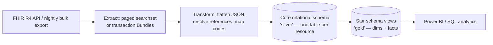
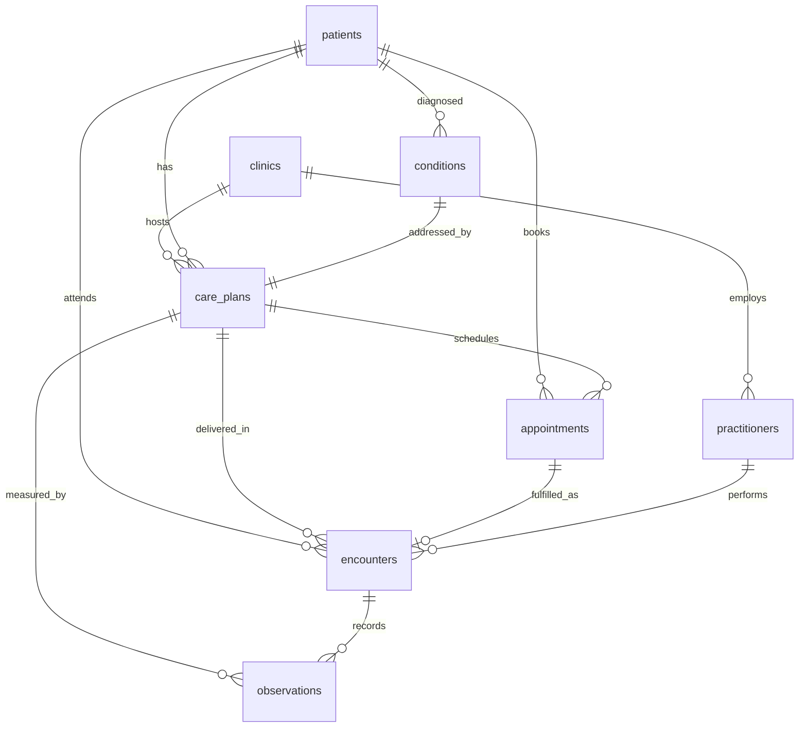

# Phase 3 — Extraction & Normalization (FHIR → SQL)

FHIR is excellent for *exchange* (nested JSON, references, extensible
terminology) but poor for *analytics* (you cannot easily `GROUP BY` a deeply
nested Bundle). The job of this phase is the classic informatics ETL: **flatten
FHIR resources into a governed relational model** that BI tools and analysts can
query efficiently.

## 3.1 Pipeline overview



Three layers, a common and defensible pattern:

- **Bronze (landing):** raw FHIR JSON, kept for audit/replay (not in this repo).
- **Silver (core):** one normalized table per resource type
  (`/sql/01_schema_ddl.sql`). This is the operational source of truth.
- **Gold (analytical):** conformed dimensions and fact views
  (`/sql/03_star_schema.sql`) plus KPI views (`/sql/05_kpi_views.sql`).

> In this portfolio the extract/transform step is emulated by
> `data/generate_synthetic_data.py`, which writes the same flattened CSVs the ETL
> would produce. This keeps the project fully runnable without a live EHR.

## 3.2 Field-level mapping (FHIR → columns)

The transform resolves FHIR references (`"Patient/p-1001"`) to surrogate integer
keys and pulls coded values out of `coding` arrays.

| FHIR path | → Column | Notes |
|-----------|----------|-------|
| `Patient.identifier(mrn).value` | `patients.mrn` | business key |
| `Patient.gender` / `birthDate` | `patients.gender` / `birth_date` | age derived in `dim_patient` |
| `Patient.address.postalCode/city` | `patients.postal_code/city` | minimised address |
| `Practitioner.identifier(license)` | `practitioners.license_number` | |
| `PractitionerRole.specialty` | `practitioners.specialty` | denormalised onto practitioner |
| `Appointment.status` | `appointments.status` | drives no-show/cancel KPIs |
| `Appointment.start` − `Appointment.created` | `appointments.lead_time_days` | computed in transform |
| `Appointment.basedOn → CarePlan` | `appointments.care_plan_id` | reference → FK |
| `Encounter.appointment → Appointment` | `encounters.appointment_id` | reference → FK |
| `Encounter.type.text` | `encounters.encounter_type` | initial-evaluation/treatment/discharge |
| `Encounter.reasonReference → Condition` | `encounters.condition_id` | |
| `Condition.code.coding(icd-10 / snomed)` | `conditions.icd10_code / snomed_code` | split dual coding |
| `Condition.bodySite.text` | `conditions.body_site` | |
| `Observation.code.coding(loinc)` | `observations.loinc_code` + `instrument` | |
| `Observation.valueQuantity.value/unit` | `observations.value_numeric / unit` | UCUM |
| `Observation` note `measure_point` | `observations.measure_point` | baseline/interim/discharge |
| `CarePlan.status` / `intent` | `care_plans.status / intent` | |
| `CarePlan.addresses → Condition` | `care_plans.condition_id` | |
| `CarePlan.activity...repeat.count` | `care_plans.planned_sessions` | planned dose |

## 3.3 The relational model

Eight core tables, one per resource. Surrogate **primary keys** mirror the FHIR
logical id; **foreign keys** implement the references from Phase 2.



### Keys and integrity

- **Primary keys:** every table has an integer surrogate PK
  (`patient_id`, `appointment_id`, …).
- **Natural keys:** `patients.mrn` is `UNIQUE`; clinical codes are attributes.
- **Foreign keys:** declared in `01_schema_ddl.sql`. One reference is
  **circular** — a `Condition` is recorded *during* an `Encounter`, while an
  `Encounter` references the `Condition` it addresses. That single FK
  (`conditions.encounter_id → encounters`) is added with `ALTER TABLE` after the
  tables exist, and dropped/recreated around the bulk load
  (`02_load_data.sql`) so rows can be inserted in dependency order.
- **Indexes:** composite indexes on the columns the dashboards filter/join on
  (`appointments(clinic_id, scheduled_date)`, `observations(care_plan_id,
  measure_point)`, etc.).

### Example DDL (abridged — full file in `/sql/01_schema_ddl.sql`)

```sql
CREATE TABLE appointments (
    appointment_id   INTEGER PRIMARY KEY,
    patient_id       INTEGER NOT NULL REFERENCES patients(patient_id),
    practitioner_id  INTEGER REFERENCES practitioners(practitioner_id),
    clinic_id        INTEGER REFERENCES clinics(clinic_id),
    care_plan_id     INTEGER REFERENCES care_plans(care_plan_id),
    status           TEXT,                 -- booked|fulfilled|cancelled|noshow
    scheduled_date   DATE,
    scheduled_start  TIMESTAMPTZ,
    created_date     DATE,
    lead_time_days   INTEGER,
    session_number   INTEGER,
    cancellation_reason TEXT
);
```

## 3.4 From normalized to dimensional (star schema)

The gold layer (`/sql/03_star_schema.sql`) exposes Power-BI-friendly objects:

- **Dimensions:** `dim_date`, `dim_patient` (with `age_band`),
  `dim_practitioner`, `dim_clinic`, `dim_diagnosis` (with body-region and the
  primary PROM instrument per diagnosis).
- **Facts:**
  - `fact_appointment` — one row per booking, with boolean flags
    (`is_noshow`, `is_cancelled`, `is_attended`) and a `lead_time_band`.
  - `fact_encounter` — one row per delivered visit.
  - `fact_outcome` — **one row per episode**, pivoting the long `observations`
    table into paired `baseline`/`discharge` values, harmonising every functional
    instrument to a 0–100 disability scale, computing adherence, length of stay,
    and **MCID achievement flags**. This view is the analytical heart of the
    project.

Defining the gold layer as **views** keeps the example portable; in production
each would be a **materialized view** (or a dbt model) refreshed nightly, so
Power BI imports pre-aggregated, governed data rather than re-deriving KPIs.

## 3.5 Generating and loading the data

```bash
# 1. Generate the synthetic CSVs (≈4 seconds)
python data/generate_synthetic_data.py

# 2. Create schema and load (PostgreSQL)
psql -d arn_db -f sql/01_schema_ddl.sql
psql -d arn_db -f sql/02_load_data.sql      # \copy from /data, re-adds circular FK
psql -d arn_db -f sql/03_star_schema.sql    # dims + facts
psql -d arn_db -f sql/05_kpi_views.sql      # KPI views for Power BI
```

Resulting volumes (reproducible, seed = 42):

| Table | Rows |
|-------|------|
| clinics | 8 |
| practitioners | 113 |
| patients | 4,500 |
| conditions | 5,467 |
| care_plans (episodes) | 5,467 |
| appointments | 64,213 |
| encounters | 51,415 |
| observations (PROMs) | 20,790 |
