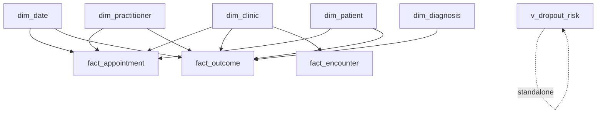

# Phase 5 — Power BI Dashboards

Three dashboards, one per audience: **Executive** (board), **Clinical** (CMO and
therapists) and **Operational** (operations director and clinic managers). All
sit on the same governed model, so every number reconciles across pages.

## 5.1 Data model in Power BI

Import the gold-layer objects as tables and build a clean **star schema**. Mark
`dim_date` as the official date table.

Relationships are single-direction (1 → \*) from dimensions to facts; avoid
bidirectional filters except where a measure genuinely needs them. All KPIs are
**measures** (see `/powerbi/dax_measures.dax`), never calculated columns, so they
respect slicer context and stay performant.

**Design principles:** one clear question per visual; KPI cards carry a target
and RAG colour; consistent colour semantics (green = good, red = attention);
accessible (colour-blind-safe palette, data labels); load time minimised by
importing pre-aggregated views.

## 5.2 Dashboard 1 — Executive Overview

**Audience:** CEO, CMO, Operations & Finance Directors. **Question:** *Is the
network healthy this month, and where is the exception?*

| # | Visual | Type | Key measure(s) | Decision it enables |
|---|--------|------|----------------|---------------------|
| 1 | Active patients & new episodes | KPI cards | `Episodes`, `Active Episodes`, `Episodes YTD` | Demand level vs plan |
| 2 | No-show rate (vs 10% target) | KPI card + RAG | `No-Show Rate %`, `No-Show RAG` | Whether capacity loss needs escalation |
| 3 | Treatment completion rate | KPI card | `Completion Rate %` | Quality-of-care headline |
| 4 | Func MCID achievement | KPI card | `Func MCID Achievement %` | Are patients actually recovering |
| 5 | KPI trend (12 months) | Line chart | `No-Show Rate % Rolling 3M`, `Completion Rate %` | Direction of travel, seasonality |
| 6 | Clinic comparison | Bar / map | `No-Show Rate %`, `Func MCID Achievement %` by `dim_clinic` | Which sites over/under-perform |
| 7 | Lost capacity (hours & cost) | Card + bar | `Clinician Hours Lost` | Size the operational prize for Finance |
| 8 | Period & clinic slicers | Slicers | `dim_date`, `dim_clinic` | Self-service filtering |

## 5.3 Dashboard 2 — Clinical Outcomes

**Audience:** CMO, clinical leads, physiotherapists. **Question:** *Are we
delivering effective, equitable recovery — and where can care improve?*

| # | Visual | Type | Key measure(s) | Decision it enables |
|---|--------|------|----------------|---------------------|
| 1 | Pain & disability: baseline → discharge | Clustered bar | `Mean Pain Reduction`, `Mean Disability Reduction` | Quantify recovery, by condition |
| 2 | MCID achievement by diagnosis | Bar with target line | `Func MCID Achievement %` by `dim_diagnosis` | Which conditions under-recover (e.g. frozen shoulder) |
| 3 | Adherence vs recovery | Scatter / column | `Mean Adherence %` vs `Func MCID Achievement %` | Evidence that adherence drives outcome |
| 4 | Mean time to discharge | Bar | `Mean Time to Discharge` by diagnosis | Set realistic episode-length expectations |
| 5 | Therapist scorecard | Table + rank | `Func MCID Achievement %`, `Episodes with Outcome` | Identify training needs / best practice (≥10-case floor) |
| 6 | Outcome trend | Line | `Func MCID Achievement %` over `dim_date` | Is quality improving over time |
| 7 | Slicers: diagnosis, body region, age band | Slicers | `dim_diagnosis`, `dim_patient` | Case-mix-adjusted views |

> Governance note: the therapist scorecard enforces a minimum case volume and is
> framed for **improvement, not ranking** — important for clinical buy-in and to
> avoid unfair comparison on small samples or harder case-mix.

## 5.4 Dashboard 3 — Operational Performance

**Audience:** Operations Director, clinic managers. **Question:** *Where is
capacity leaking and which patients need a call today?*

| # | Visual | Type | Key measure(s) | Decision it enables |
|---|--------|------|----------------|---------------------|
| 1 | Appointment funnel | Funnel | `Resolved`, `Attended`, `No-Shows`, `Cancellations` | See where bookings are lost |
| 2 | No-show heatmap: lead-time × weekday | Matrix (RAG) | `No-Show Rate %` | Target reminder & overbooking policy |
| 3 | No-show / cancellation by clinic | Bar | `No-Show Rate %`, `Cancellation Rate %` | Focus operational support |
| 4 | **Drop-out risk register** | Table + drillthrough | `Patients At Risk`, `High Risk Patients`, `Sessions At Risk` | The weekly call list per clinic |
| 5 | Cancellation reasons | Donut | count by `cancellation_reason` | Address root causes (e.g. reschedules) |
| 6 | Capacity utilisation by clinic/day | Matrix | `Attended Appointments` | Rebalance staffing |
| 7 | Slicers: clinic, practitioner, week | Slicers | dims | Manager self-service |

The **drop-out risk register** (visual 4) is the most operationally valuable
object in the platform: it lists, per clinic, the active patients with the
longest attendance gaps and the most remaining sessions, with a drillthrough to
the patient's visit history. It is the bridge from "insight" to "someone picks
up the phone".

## 5.5 Interactivity, security and refresh

- **Cross-filtering & drillthrough:** click a clinic to filter the page; drill
  from a risk tier to the patient list; drill from a diagnosis to its episodes.
- **Row-Level Security (RLS):** a `Clinic Manager` role filters
  `dim_clinic[clinic_id]` to the user's site so managers see only their own
  patients — essential for GDPR data minimisation.
- **Refresh:** scheduled nightly after the ETL and view refresh; the drop-out
  register is the most time-sensitive and could move to more frequent refresh.
- **Pseudonymisation:** dashboards show MRN, never name; re-identification stays
  inside the EHR.

See `/powerbi/dax_measures.dax` for the full measure library and
`/powerbi/README.md` for connection steps.
